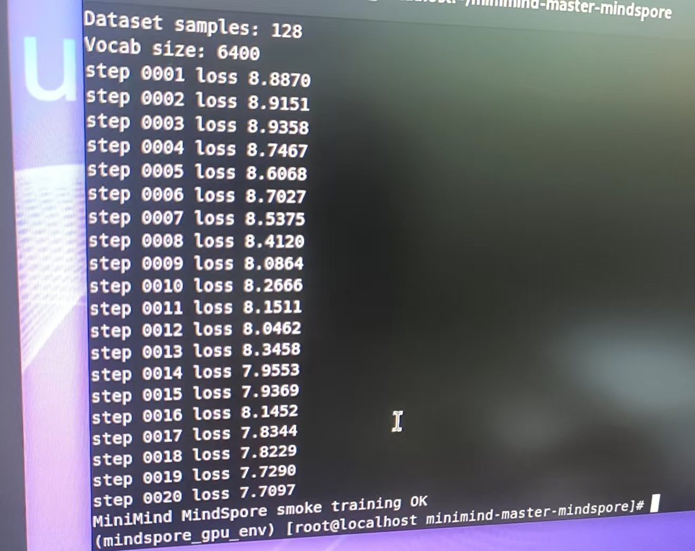
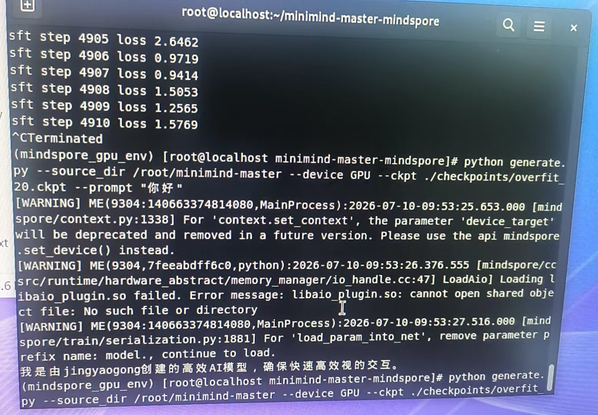
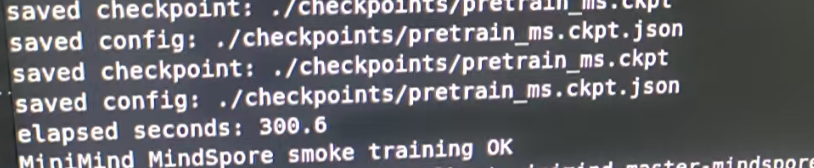
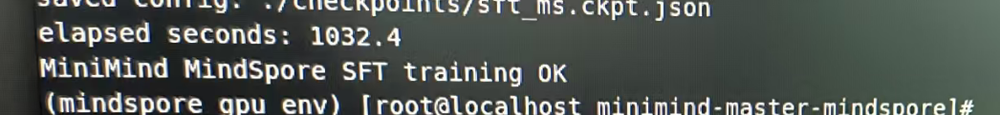
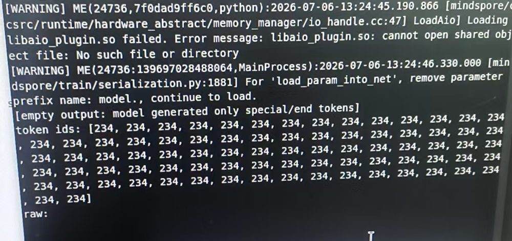
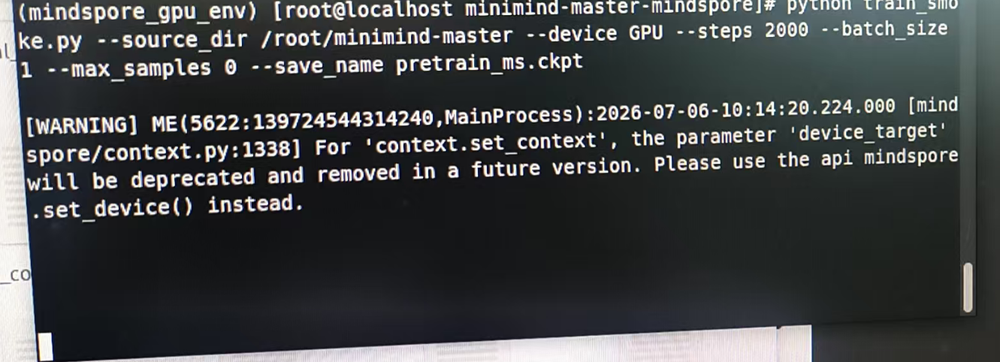

# Experiment log

Run records for the MindSpore port. The goal of this file is reproducibility, not benchmarking: an entry should let someone else rerun the same command on a similar machine.

Everything below comes from the run notes and terminal screenshots of the original lab machine, not from memory. Where a number was not captured, the entry says **not recorded** instead of estimating one.

## Verified environment

| Item | Value |
|---|---|
| OS | openEuler 24.03 LTS SP4 (x86_64, UEFI + GPT, standard DVD image) |
| GPU | NVIDIA GeForce GTX 1080 Ti (GP102), 11 GB, single card |
| Driver | NVIDIA 580.173.02 (`NVIDIA-Linux-x86_64-580.173.02.run`) |
| CUDA toolkit | 11.6.0 (`cuda_11.6.0_510.39.01_linux.run`, toolkit only — the driver it bundles is not installed) |
| cuDNN | 8.5.x for CUDA 11 |
| MindSpore | **2.9.0**, GPU build, from `repo.mindspore.cn`, virtualenv `~/mindspore_gpu_env` |
| Python | 3.8 |
| Execution mode | `ms.PYNATIVE_MODE`, `float32` |
| Tokenizer / data | unmodified upstream MiniMind checkout via `--source_dir`, `dataset/` from ModelScope |

Verified bottom-up, in this order — each step is a separate failure domain, and skipping one makes the next error message lie about its cause:

```bash
nvidia-smi                 # driver sees the card
nvcc --version             # CUDA toolkit on PATH, release 11.6
python -c "import mindspore; mindspore.set_device(device_target='GPU'); mindspore.run_check()"
python run_check.py        # this repo reaches the device
```

## Environment notes (the parts that cost hours)

- **Nouveau must be blacklisted before the NVIDIA `.run` installer will work**: `blacklist nouveau` in `/etc/modprobe.d/`, then `dracut --force`, then reboot. Installing over the live open-source driver is the classic way to get an X server that never starts again.
- **`kernel-devel` must match `uname -r` exactly**, otherwise the module build fails with a version-mismatch error that reads like a compiler problem.
- **Secure Boot must be off**; on this board the setting was `OS Type -> Other OS` in the BIOS.
- **Install in `multi-user.target`, not the desktop session.** The `.run` installer cannot unload an in-use display driver.
- **MindSpore wheels are built per CUDA major version.** A cu12 wheel on a cu11 host fails at `import` or at the first kernel launch, not at `pip install`.
- **`LD_LIBRARY_PATH` needs both the CUDA `lib64` and the system `lib64`** on openEuler; dropping the system path produces a `libstdc++` resolution error that looks like a MindSpore bug.
- `libaio_plugin.so failed ... No such file or directory` is a warning, not a failure — MindSpore still reports the GPU backend as available. `dnf install -y libaio libaio-devel` silences it.

## Run record template

Copy this block for each run. Record the commit hash — `git rev-parse --short HEAD` — because a run without it is not reproducible.

```text
date:
commit:
command:
config:      hidden / layers / heads / kv_heads / max_seq_len / batch / grad_accum / steps / lr
             (record both batch and grad_accum: together they define the effective
              batch, and a run is not reproducible from only one of them)
data:        which JSONL, how many samples (--max_samples)
elapsed:
loss (first / last / min):
output:      checkpoint path + its .json sidecar
observation:
```

## Runs performed

All runs used the script defaults for model shape — 768 hidden, 8 layers, 8 heads, 4 KV heads, vocab 6400, **80.6 M parameters** — and `--batch_size 1`, which is what an 11 GB card and `float32` allow at these sequence lengths.

| # | Stage | Data | seq | Steps | Elapsed | Result |
|---|---|---|---|---|---|---|
| 1 | GPU check | — | — | — | — | `MindSpore GPU check OK` |
| 2 | Overfit check | 128 samples | 340 | 20 | not recorded | loss 8.8870 → **7.7097**; generates fluent text (below) |
| 3 | Pre-train | full `pretrain_t2t_mini` | 340 | 2,000 | **300.6 s** (0.150 s/step) | checkpoint + sidecar written |
| 4 | SFT | full `sft_t2t_mini` | 768 | 2,000 | **1,032.4 s** (0.516 s/step) | checkpoint + sidecar written; generation collapses (failure mode 1) |
| 5 | SFT (continued) | full `sft_t2t_mini` | 768 | 4,910 then `^C` | not recorded | loss ≈ **1.0–1.6** per micro-batch |
| 6 | Inference | — | — | — | — | `generate.py`, `eval_chat.py` — see failure modes |



## 1. The overfit check: the cheapest proof that the port works

Before training anything large, 128 samples were memorised for 20 steps. This is the most informative run in the project, for three reasons:

- **The first step starts at chance.** Loss is 8.8870 at step 1; random guessing over a 6400-token vocabulary costs `ln(6400) = 8.7641`. The 1.4 % excess is the overhead of a uniform distribution that is not perfectly flat. If the first loss had been 5.0, or 0.1, that alone would indicate a broken loss, a mis-mapped label, or logits in the wrong order — this is the cheapest sanity check available, and it takes one step.
- **It learns immediately.** Twenty steps at learning rate 5e-4 took the loss from 8.8870 to 7.7097 — **−1.18 nats** — which cannot happen by accident on 128 fixed samples.
- **The checkpoint produces language.** Generating with `overfit_20.ckpt` and the prompt `你好` gives a fluent, correctly formatted Chinese answer:

  

  ```text
  $ python generate.py --ckpt ./checkpoints/overfit_20.ckpt --prompt "你好"
  我是由jingyaogong创建的高效AI模型，确保快速高效视的交互。
  ```

  The sentence is memorised from the small fine-tuning set — this is a **correctness** result, not a quality result. What it establishes is the part that framework ports usually get wrong: the tokenizer, the prompt template, the label mask, the attention mask, the RoPE table, the checkpoint loader and the greedy decoder all agree with each other end to end.

The same screenshot carries the two MindSpore warnings discussed in section 3 of [`migration-notes.md`](migration-notes.md) — the `set_context` deprecation and the `model.` key prefix.

## 2. What a longer run costs




- **Throughput.** 340 padded tokens per sample at 0.150 s/step is roughly **2,260 tokens/s** forward+backward; 768 tokens at 0.516 s/step is roughly **1,490 tokens/s**.
- **Superlinear cost.** SFT takes **3.43×** the time per step of pre-training for **2.26×** the sequence length. That is the expected shape of an attention term that grows with `T²` plus a 768 × 6400 logits tensor, and it makes `--max_seq_len` the most expensive knob in this repository.
- **Budget.** 2,000 steps at batch size 1 is 2,000 samples — a small fraction of the 1.2 GB mini pre-training set.

## 3. The long SFT run: loss comes down, batch 1 stays noisy

Continuing SFT to step 4,910 (interrupted with `^C`) brought the per-micro-batch loss into the 1.0–1.6 range. The last six logged steps were:

```text
sft step 4905 loss 2.6462
sft step 4906 loss 0.9719
sft step 4907 loss 0.9414
sft step 4908 loss 1.5053
sft step 4909 loss 1.2565
sft step 4910 loss 1.5769
```

Mean 1.48, range 0.94–2.65 across six consecutive steps. At `batch_size 1` each logged loss is a single sample, so this scatter is the minibatch noise, not instability — it is also the concrete argument for `--grad_accum`: at the default learning rate the gradient of one sample is far too noisy to be the unit of optimisation. No generation from this checkpoint was captured, so this run establishes that the loss descends, not that the model got better.

## Observed failure modes

### 1. Empty output, then a single-token loop

**Symptom.** After 2,000 pre-training steps and 2,000 SFT steps at `max_seq_len` 768, `generate.py` returns nothing, and with EOS suppression disabled the model emits one token id forever:



That terminal shows three things at once, and it is the whole diagnosis in one frame:

1. `[empty output: model generated only special/end tokens]` — the diagnostic from `generate.py`, not a crash.
2. `token ids: [234, 234, 234, ...]` — the model has collapsed onto one token and will not leave it.
3. Two MindSpore warnings: a missing `libaio_plugin.so` (harmless) and `For 'load_param_into_net', remove parameter prefix name: model.` — the checkpoint carries a `model.` prefix that the loader strips.

**Cause, in order of likelihood.** With assistant-turn-only labels and only 2,000 steps, the cheapest way to reduce the loss is to emit the end-of-sequence token immediately. The `234` loop is the same collapse with EOS suppressed: arg-max over a near-uniform distribution is a fixed point. Three things point the same way — the overfit run reaches fluent output in 20 steps, so the decode path is fine; the 4,910-step run pushes the loss to ~1.0, so the objective does descend; and 2,000 samples of a 1.2 GB corpus is a rounding error. The variable is training budget, not the port.

**Caveat on that comparison.** The overfit run used the pre-training learning rate (5e-4); SFT uses 1e-5. Data volume and learning rate differ between the two runs, so the contrast identifies a direction, not a single cause.

**Mitigation in the repo.** `--min_new_tokens` suppresses EOS for the first few steps so the model is forced to produce tokens; the diagnostic branch reports the case instead of hiding it. `serve.py` carries the same policy into the web demo via the `empty` flag.

**Real fix .** More steps at a sane effective batch (`--grad_accum`), more data, loss weighting on the first assistant token, and sampling with a repetition penalty.

### 2. Loss falls while output quality falls

**Symptom.** Training loss decreases monotonically; generations get shorter and less relevant.

**Cause.** Not a framework bug. It is the label mask plus the data distribution: the loss only measures the assistant tokens, and on a small sample the shortest acceptable answer wins. This is the case where the metric and the objective diverge.

**Diagnostic order that worked.** (1) Inspect the label mask for one batch — are the intended tokens actually supervised? (2) Inspect the rendered prompt — does it match what inference builds? (3) Inspect the checkpoint's `.json` sidecar — is inference rebuilding the shape that was trained? Only after those three does it make sense to suspect an operator.

### 3. A deprecation warning that will become a break

MindSpore 2.9 prints, once per process:



```text
[WARNING] ... For 'context.set_context', the parameter 'device_target' will be
deprecated and removed in a future version. Please use the api mindspore.set_device() instead.
```

Every entry point calls `ms.set_context(mode=..., device_target=...)`, which works on 2.9 but is on a removal path. The 2.9 spelling is `ms.set_context(mode=...)` followed by `ms.set_device(device_target=...)`. This repository keeps the old form deliberately — it also runs on MindSpore 2.x builds that predate `set_device` — and this is the one call a future MindSpore major version will break.

## What is still not measured

- **The full loss curve.** First-step and last-step values exist for the overfit run and a six-step window for the long SFT run, but no complete curve was captured. Both runs printed every step; the screenshots simply begin too late.
- **Peak VRAM.** `nvidia-smi` was watched during training but no number was captured.
- **Generation throughput.** Only training throughput is known; the web demo reports tokens/second per request, and it has not been run against a checkpoint yet.
- **Numerical parity against PyTorch.** See [`migration-notes.md`](migration-notes.md), section 4. This is the largest gap.
- **Any evaluation.** No held-out set, no benchmark, no quality metric. The chat, tool-call and web scripts are demos.

## If you re-run this

Capture these six items and this log becomes a complete experiment record:

1. **The whole loss line sequence**, or at least steps 1, 10, 100, 1,000 and the last. Everything above could have been reconstructed from one `tee` of the terminal.
2. Peak VRAM: `nvidia-smi --query-gpu=memory.used --format=csv -l 2` alongside training.
3. `git rev-parse --short HEAD` at the moment of the run.
4. The full command line, including `--grad_accum` and `--max_samples`.
5. A generation from *each* checkpoint that matters, not only the one that worked.
6. Wall-clock elapsed, which `StepTimer` already prints (that is where the 300.6 s and 1,032.4 s above came from).
